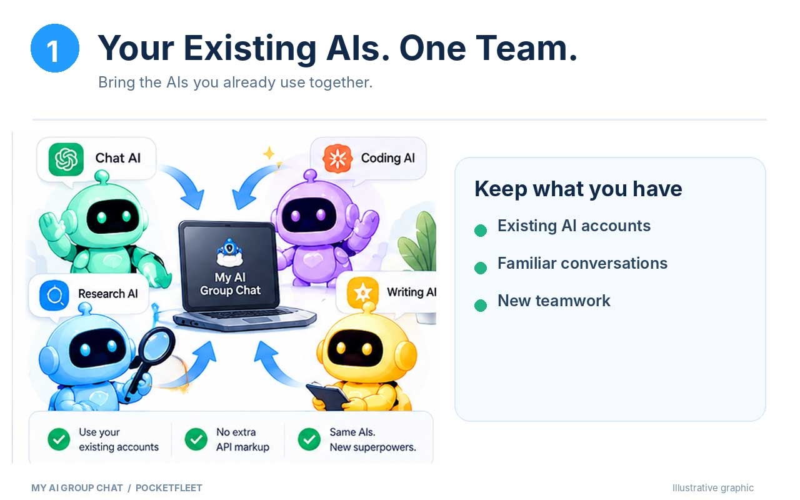
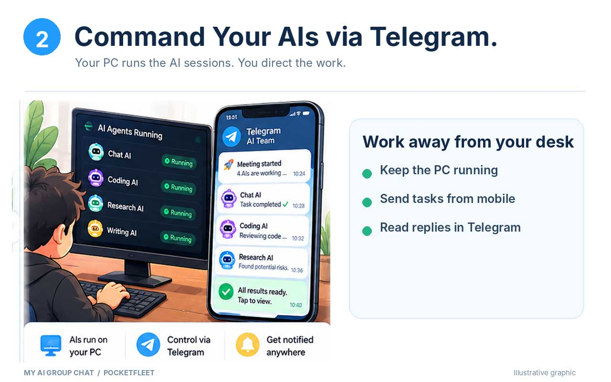
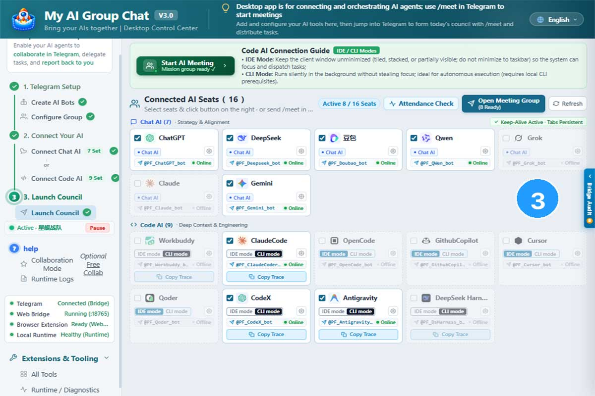
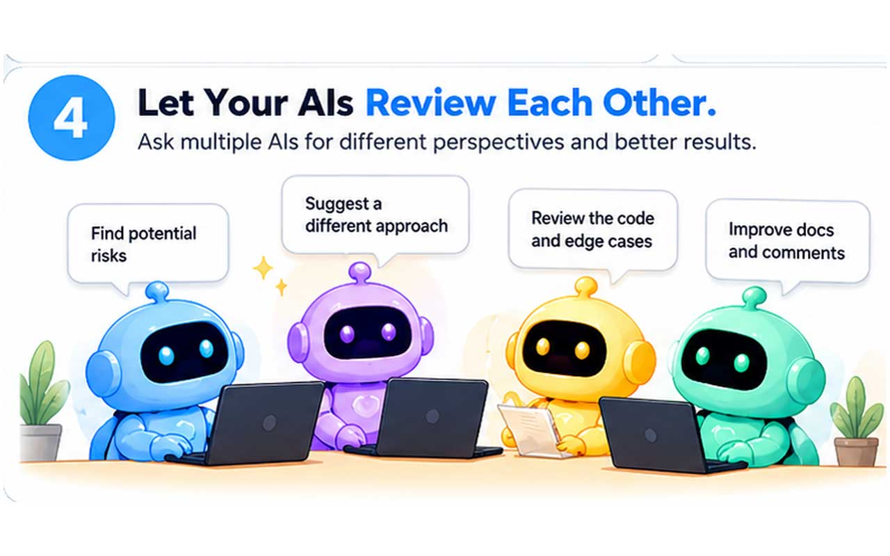
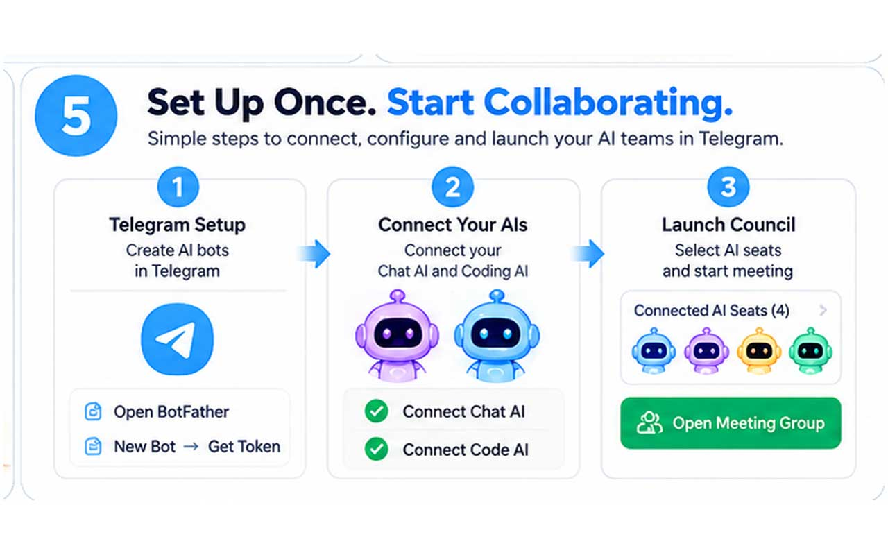

<div align="center">

# My AI Group Chat

**English** | [简体中文](README.zh-CN.md)

**Bring Your Existing AI Subscriptions Together.**
*Stop paying twice for AI power. Amplify the tools you already subscribe to — no extra per‑token API markup.*
Built for indie hackers & developers orchestrating multi-model code reviews, architecture cross-checks, and refactors.

[](LICENSE)
[](#system-requirements)
[](browser-extension/)
*Powered by the PocketFleet orchestration engine*

[How It Works](#why-my-ai-group-chat) | [Quick Start](#get-started-in-three-steps) | [Pricing](#licensing-pricing) | [Trust & Privacy](#local-first-trust-disclosures) | [Documentation](docs/Detailed-User-Guide.md) | [Telegram](https://t.me/myaigroupchat)
</div>



---
## Why My AI Group Chat?
You are already paying monthly for ChatGPT Plus, Claude Pro, or other coding‑focused AI services. You have spent hours building context, workflow habits, and useful chat histories inside these browser‑based AI sessions.

Today, making multiple AIs collaborate forces you to manually copy‑paste prompts and outputs between tabs. **You become the human messenger between your models.**

**My AI Group Chat** connects your existing browser and local code‑agent sessions into a coordinated fleet.
* **BYOS (Bring Your Own Subscriptions)**: Reuse your active browser AI sessions. No additional API bills from us. We do not generate brand‑new blank‑state API‑based AI instances. We work with the models you already know and trust. *(Note: We do not claim full historical‑memory inheritance across sessions).*
* **AI‑Orchestrates‑AI**: Assign one of your trusted AIs as the meeting host. It can dispatch work, request peer reviews, and aggregate outputs from other connected agents. Host‑agent guidance improves task splitting, but results depend on underlying model quality and prompt design. Complex task decomposition is assisted, but not guaranteed for every arbitrary prompt.
* ✅ **Async Telegram Pager / Remote Console**: Kick-off long-running multi-agent refactors or reviews from your desktop, then step away. Your Windows machine and logged-in AI browser tabs stay powered-on to run workflows. Telegram acts as your asynchronous mission control—streaming agent milestones, flagging human-approval gates, and delivering final deliverables directly to your phone. Step away from your desk while your local fleet coordinates. *(Telegram is used purely as your remote notification & command interface; we are not affiliated with Telegram).*

> **Example Real‑World Workflow**:
> Let one agent draft architecture, another implement frontend UI, a third audit edge‑case risks — all running concurrently on your local Windows machine. You get notified on mobile when human input is required.



<details>
<summary>See the actual desktop control center</summary>



*Example workspace. Participating AI seat limits depend on your license.*

</details>

<details>
<summary>See your AIs review each other's work</summary>



</details>

*Stop manually copying messages between AI windows — let your fleet do the hand‑offs.*

---
<a id="get-started-in-three-steps"></a>

## 🚀 Get Started in Three Steps
```text
You (Telegram Remote) ◄──► Telegram Bots ◄──► My AI Group Chat (Desktop Engine)
                                                      │
                       ┌──────────────────────────────┴──────────────────────────────┐
                       ▼                                                             ▼
         Local Web Bridge (:18765)                                     Local Code Agents
      (Supported Browser AIs)                        (Supported Local Code Agents)
```

1. **Prepare Telegram Bot & Collaboration Group**
   - Create your dedicated Telegram bots via BotFather and a private meeting group.
   - *(Full step‑by‑step instructions → [Detailed User Guide](docs/Detailed-User-Guide.md))*.
2. **Connect Your Existing AIs**
   - **Browser AIs**: No extra API keys required. Reuse your active, logged‑in browser sessions via the companion extension.
   - **CLI / Code Agents**: May require their own native authentication or API credentials.
3. **Launch Your Agent Fleet**
   - From your desktop, prepare participating seats.
   - Send `/meet` inside your Telegram group to start coordination. Walk away; your Windows machine keeps working while you receive alerts and outputs on mobile.

<details>
<summary>See the three-step setup</summary>



</details>

---

<a id="licensing-pricing"></a>

## 💰 Licensing & Pricing

All tiers share one **identical Windows binary**. Save as many AI configurations as you need; your tier limits only how many AI seats are enabled for collaboration and task dispatch at the same time. Human users do not consume seats.

*Most competing multi‑agent tools charge $15–$30 per month. Our Solo tier is $19.99 per year.*
✅ **Free tier is production‑capable**: run real code review workflows with two agents.

| Tier | Simultaneously Enabled AI Seats | Price | Validity | Notes |
| --- | --- | --- | --- | --- |
| **Free** | **2 Seats** | **$0** | **Permanent** | Fully functional dual‑AI review |
| **Solo** | **4 Seats** | **$19.99** | **12 months** | Full‑stack & parallel task splitting |
| **Team** | **6 Seats** | **$39.99** | **12 months** | Advanced multi‑agent pipelines |
| **Ultra** | **12 Seats** | **$79.99** | **12 months** | High‑density multi‑model clusters |

*Paid tiers are sold through Lemon Squeezy: [pocketfleet.lemonsqueezy.com](https://pocketfleet.lemonsqueezy.com) — one payment, 12 months of use, no auto-renewal.*

Early preview participants can claim a **30-day Solo 4-seat key** by contacting the author or joining our early-access community. Simply paste your key into the desktop control center—no credit card required. When expired, your configuration persists and gracefully falls back to the permanent Free 2-seat limit. *(Experience codes are not pre-bundled inside installation packages).*

## Contact & Early Access

Questions, preview-code requests, or feedback? Connect with us on Telegram: **[@myaigroupchat](https://t.me/myaigroupchat)**.

Prefer email? Reach the author at **[hi.yihua@gmail.com](mailto:hi.yihua@gmail.com)**.

Click the link above on your phone, or scan this QR code:

<a href="https://t.me/myaigroupchat"></a>

---

<a id="system-requirements"></a>

## 💻 System Requirements & Status

- **OS**: Windows 10 / 11 x64 desktop machine (must remain powered‑on while running agent workflows with AI browser sessions available).
- **Network**: Direct network access to Telegram and your chosen AI provider services.
- **Installer Status**: **v3.0.0 is published (early preview).** Download the installer (per-user, no UAC prompt) or the portable zip from [GitHub Releases](https://github.com/PocketFleet-AI/my-ai-group-chat/releases). The installer opens the user guide and the bundled `browser-extension/` folder automatically when it finishes, so you can install the Web Bridge extension right away.
- **Browser extension**: install *PocketFleet Web Bridge* from the Chrome Web Store, or load the bundled `browser-extension/` folder via `chrome://extensions` → Developer mode → Load unpacked (required for ChatGPT / Claude / Gemini / DeepSeek web sessions).

---

<a id="local-first-trust-disclosures"></a>

## 🔒 Local‑First & Trust Disclosures

*Critical for Indie Hacker & r/LocalLLaMA audiences:*

1. **Zero‑Cloud‑Proxy Architecture**: Orchestration control‑flow runs over local loopback `127.0.0.1:18765`. No PocketFleet‑operated central message proxy intercepts your prompts.
2. **Open-Source Extension**: The companion browser extension is fully open-source under **Apache-2.0** for complete security auditing. Zero analytics trackers or tracking telemetry. To keep up with AI website UI changes without breaking your workflow, it fetches signed DOM-locator rules from Cloudflare Workers (connection metadata only, zero conversation payload).
3. **No Vendor Lock‑In**: Freely mix and match any supported browser AI and local code agent seats.
4. **Important Factual Boundary**: *Local‑first orchestration ≠ all data never leaves your PC.* Task payloads travel to your selected AI providers and through the Telegram Bot API, subject to those platforms' respective privacy policies. Do not feed highly sensitive material without reviewing third‑party terms.

---

## 📚 Further Resources

Deep technical parameters, architecture diagrams, and configuration guides live here:

- [Full Setup & IDE/CLI Mode Notes](docs/Detailed-User-Guide.md)
- [Architecture & Deep Privacy Document](docs/ARCHITECTURE.md)
- [Browser Extension Source Code](browser-extension/)
- [Open Issues & Feedback](https://github.com/PocketFleet-AI/my-ai-group-chat/issues)

*(The desktop orchestration binary is proprietary and is not built from the browser‑extension repository alone.)*
